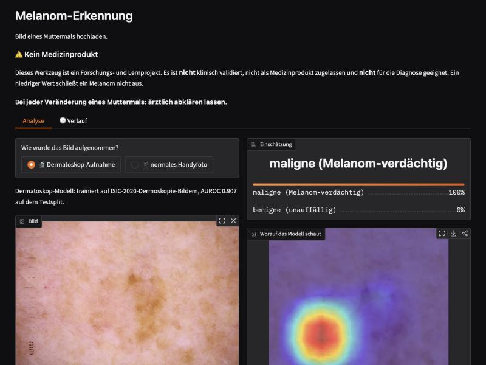

# Melanoma Detection

Upload a photo of a mole → probability of "benign" vs. "malignant", plus
personal tracking of the same mole over time. A computer-vision project built
on four public datasets (**both** dermoscopic and clinical/phone-camera
images).



| Model | Trained on | AUROC | Evaluated on |
|---|---|---|---|
| `isic_baseline` | `isic2020` only | **0.9075** | ISIC test split (dermoscopy) |
| `isic_baseline` (no adaptation) | — | **0.7884** | `pad_ufes_20` (phone photos) — a clear drop |
| `pad_ufes_final` | `isic_baseline` + fine-tuned on `pad_ufes_20` | **0.9132** (5-fold cross-validation) | `pad_ufes_20` (phone photos) |

---

## ⚠️ Not a medical device

This project is a **learning and research project**. It is not clinically
validated, not approved as a medical device (MDR/FDA), and not intended for
diagnostic use. A low score does **not** rule out melanoma. Any change in a
mole should always be checked by a doctor.

---

## Data sources

| Key | Source | Size | Access | Labels | Image type |
|-----|--------|------|--------|--------|------------|
| `isic2020` | [ISIC Archive](https://challenge.isic-archive.com/data/) (= the SIIM-ISIC competition data) | 33,126 images, 23 GB | **open, no account** | ground-truth CSV, 584 malignant (1.76 %), with patient and lesion IDs | dermoscopy |
| `mittal` | [Melanoma Cancer Dataset](https://www.kaggle.com/datasets/bhaveshmittal/melanoma-cancer-dataset) | 13,879 images, 79 MB | **open, no account** | `Benign` / `Malignant` folders, 47.5 % malignant | dermoscopy |
| `javed` | [Melanoma Skin Cancer Dataset (10,000 images)](https://www.kaggle.com/datasets/hasnainjaved/melanoma-skin-cancer-dataset-of-10000-images) | 10,605 images, 99 MB | **open, no account** | `benign` / `malignant` folders, 48.1 % malignant | dermoscopy |
| `pad_ufes_20` | [PAD-UFES-20](https://arxiv.org/abs/2007.00478), mirrored on the [ISIC Archive](https://api.isic-archive.com/collections/406/) | 2,298 images, 220 MB | **open, no account** | 52 melanomas (2.3 %), rest BCC/SCC/nevus/keratosis, biopsy-confirmed | **phone photo (clinical)** |

The main dataset, `isic2020`, is deliberately downloaded **directly from the
ISIC Archive** rather than via Kaggle. It's the same images, but: no Kaggle
account needed, no joining the competition, and the ground-truth file there is
the newer `v2` version, which additionally includes `lesion_id`. On top of
that, there's an official list of 424 known duplicate pairs.

`pad_ufes_20` is downloaded through the same ISIC Archive route (collection
406), also without an account. It's the only dataset here with **real phone
photos** instead of dermoscopic images — see ["Two models, two image
types"](#two-models-two-image-types) below for why that matters.

Licenses: `isic2020`/`mittal`/`javed` are **CC-BY-NC 4.0**, `pad_ufes_20` is
**CC-BY**. Citation requirements → [`CITATION.md`](CITATION.md).

### Two things that easily go wrong here

**1. The sources overlap — massively.** All three dermoscopy sources come
directly or indirectly from the ISIC Archive. Measured on `mittal` + `javed`
alone:

```
24,484 images  ->  12,476 after deduplication   (49 % were duplicates)
mittal: 13,879 ->   2,187                        (84 % were already in javed)
```

Naively merging them and splitting randomly leaks roughly half of the
validation images into training — AUROC then looks excellent while the model
is actually bad. That's why a **cross-source deduplication** step
(`melanoma.data.dedup`, see below) runs before the split, without exception.

**2. SIIM contains multiple images per patient.** Without a group-wise split,
validation partly measures patient recognition instead of melanoma detection.
`melanoma.data.splits` therefore groups by `patient_id` while stratifying by
label at the same time.

### Storage requirements

The full Kaggle download of the competition would be ~108 GB — but most of
that is **redundant, not additional unlabeled data**: the same images exist
there three times over (JPEG, DICOM, and TFRecords). We only download the
JPEG version of the training set.

| | Size | |
|---|---|---|
| `ISIC_2020_Training_JPEG.zip` | 23.0 GB | downloaded |
| Ground truth + duplicate list | 2.3 MB | downloaded |
| `mittal` + `javed` | 178 MB | downloaded |
| `pad_ufes_20` | 220 MB | downloaded (only for the phone-photo model) |
| DICOM training set | ~23–49 GB | same images, different container |
| TFRecords | ~30 GB | same images, TPU packaging |
| Test set (JPEG + DICOM) | ~22 GB | labels withheld by the challenge |

While unpacking, about 46 GB is briefly used; the ZIP is deleted automatically
afterward (`--keep-zip` keeps it). **Total ~23.4 GB** of raw data on disk for
all four sources.

Check exact sizes up front without downloading anything:

```bash
.venv/bin/python -m melanoma.data.download --dry-run
```

Nothing of value would be lost from the DICOM files: resolution is irrelevant
at the 384 px training size, and the metadata (age, sex, anatomical site) is
already in the ground-truth CSV anyway.

---

## Setup

```bash
make setup        # venv + dependencies
```

### Credentials

**None needed.** All four datasets are openly accessible and can be
downloaded without an account or API token (ISIC Archive directly, and for
Kaggle via the download endpoint without an `Authorization` header).

If Kaggle ever locks this down, it will show up as an HTTP 401/403; the
fallback via a free API token is documented in the docstring of
`download_kaggle_dataset()`.

---

## Workflow

```bash
make download     # download raw data (isic2020, mittal, javed)      -> data/raw/        (~23 GB, one-time)
make data         # manifest + dedup + prepare + split                -> data/processed/splits_default.csv
make train        # training (default backbone: ISIC split)           -> artifacts/baseline/best.pt
make calibrate    # calibration on val                                 -> artifacts/baseline/calibrator.json
make evaluate     # test metrics                                       -> reports/metrics_*.json
make app          # Gradio UI (both models)                            -> http://127.0.0.1:7860
```

`make data` runs in four steps: **build manifest → deduplicate → downscale
(`prepare`, ~10x faster loading during training) → split.** The split config
in `configs/default.yaml` (`sources` / `eval_sources`) controls which sources
are included at all, and which ones val/test are allowed to come from — see
the next section for why this matters here.

The production splits actually used (already generated with the correct
`--sources`/`--eval-sources` flags):

```bash
.venv/bin/python -m melanoma.data.splits --name isic --sources isic2020 --eval-sources isic2020
.venv/bin/python -m melanoma.data.splits --name all  --eval-sources isic2020   # + javed/mittal in training only
```

Single images without the UI:

```bash
.venv/bin/python -m melanoma.predict path/to/image.jpg --run-name isic_baseline
```

### Quick trial run before the full data is in place

```bash
.venv/bin/python -m melanoma.data.download --sources javed   # smallest dataset
make data
.venv/bin/python -m melanoma.train --backbone resnet18 --epochs 2 --image-size 224 --limit 2000
```

---

## Two models, two image types

Dermoscopic images (close-up, illuminated from within the device, no ambient
light) and ordinary phone photos look structurally completely different. A
model trained only on dermoscopy doesn't simply transfer to phone photos —
we **measured this instead of assuming it**:

| Model | Training data | AUROC | Where |
|---|---|---|---|
| `isic_baseline` | `isic2020` only | **0.9075** | ISIC test split (dermoscopy) |
| `isic_baseline` (unadapted) | — | **0.7884** | `pad_ufes_20` (phone photos) — a clear drop |
| `pad_ufes_final` | `isic_baseline` + fine-tuned on `pad_ufes_20` | **0.9132** (5-fold cross-validation) | `pad_ufes_20` (phone photos) |

The pure dermoscopy model loses **~0.12 AUROC** once it hits phone photos.
Fine-tuning on PAD-UFES-20 (only 52 melanoma cases in total, so evaluated via
group cross-validation rather than a single split — see
`melanoma.finetune_pad_ufes`) closes almost all of that gap.

**That's why the app has an explicit "How was this photo taken?" selector**
that switches between two checkpoints — `isic_baseline` for dermoscopic
images, `pad_ufes_final` for ordinary photos. Feeding an image to the wrong
model measurably worsens the number (see table).

How the cross-domain evaluation and fine-tuning work:

```bash
# How well does an existing model do on a structurally different dataset? (no training)
.venv/bin/python -m melanoma.eval_external --dataset pad_ufes_20 --run-name isic_baseline

# Fine-tuning with 5-fold group cross-validation (out-of-fold AUROC over all 2,298 images)
.venv/bin/python -m melanoma.finetune_pad_ufes --run-name pad_ufes_finetune --epochs 12

# Final production model on (almost) all of PAD-UFES-20
.venv/bin/python -m melanoma.finetune_pad_ufes --final --run-name pad_ufes_final --epochs 12
.venv/bin/python -m melanoma.calibrate --run-name pad_ufes_final
```

### What do the other raw datasets add? (a negative result)

The obvious idea: just throw `javed` and `mittal` into training too, more
data should be better. Tested, with a clean evaluation (val/test stays
**identical** pure `isic2020` across both runs, only the training data
differs — via `split.eval_sources`):

| Training data | Val AUROC | **Test AUROC** |
|---|---|---|
| `isic2020` only (`isic_baseline`) | 0.9069 | **0.9075** |
| `isic2020` + `javed` + `mittal` (`all_sources_baseline`) | 0.9054 | **0.8778** |

Both runs look nearly identical on val — but on the independent test split,
the run with the extra data drops noticeably (**−0.03 AUROC**). The likely
reason: after deduplication, `javed`/`mittal` consist almost entirely of
malignant images and are trivially distinguishable from the rest by
resolution alone (300×300 vs. 6000×4000) — a domain shift that the extra
positive examples don't make up for. **Consequence:** the production model
uses only `isic2020`; `javed`/`mittal` remain candidates for more targeted
experiments (e.g. with sample weighting instead of a full merge), but not for
naively pooling everything together.

### Non-square photos: crop instead of padding (also tried, discarded)

A wide or tall photo has to become a square somehow before classification.
The default here is **resize + center-crop**: the edges get cut off. For a
very wide, off-center phone photo, that can in the worst case crop out part of
the lesion — which made **padding** a tempting alternative (keep the whole
image, fill the margins by mirroring, see
`melanoma.data.dataset.build_transforms(..., pad_to_square=True)`). Measured
instead of assumed:

| Eval transform | ISIC test AUROC |
|---|---|
| Resize + center-crop (default) | **0.9075** |
| Padding instead of crop | **0.878** (−0.03) |

Padding makes things **worse**, not better: training runs on
`RandomResizedCrop` over the same (rectangular) raw ISIC images, so the model
has learned to expect a particular crop/zoom. A fully padded image looks
unusually "zoomed out" by comparison, and that costs AUROC. **Consequence:**
crop remains the default; `pad_to_square` exists as a tested but deliberately
disabled option (`--pad-to-square` flag in `evaluate.py`/`eval_external.py`).
The actually sensible response to poorly framed photos is a recommendation to
the user (center the lesion, fill the frame), not an intervention in
preprocessing.

While looking into this, a real bug turned up: the Grad-CAM heatmap ("what the
model is looking at" in the app) generated its background via a standalone
`image.resize((size, size))` — which **squashes** a non-square photo instead
of cropping it, showing a different crop than the one actually classified.
Fixed by having the heatmap and the classification share the same crop
(`build_preview_crop()` in `dataset.py`).

---

## Tracking over time

A single photo says little about **change** — and "evolving" is one of the
five ABCDE criteria for melanoma suspicion. The `🕒 History` tab in the app
lets you follow the same mole (under a freely chosen label, e.g. "upper left
back") across multiple photos over time:

- Photos land in a chronological gallery for your own visual comparison.
- The model's probability over time is shown as a curve, with a note if it
  has risen noticeably since the first photo.

**Deliberately no automatic size or color measurement.** Without a fixed
camera distance and a reference scale, an "area +12 %" claim would be
simulated precision — exactly the kind of number a research project without
calibration shouldn't put out. The model-probability curve, in contrast, is
an honest signal: the same model measures the same way at every photo.

Data lives locally under `tracking/` (photos + `index.json`) — **never in the
git repo** (`.gitignore`), since this is personal health data.

---

## How the probability is derived

A network's raw sigmoid output is not an honest probability — it's typically
overconfident. On top of that, the minority class is oversampled during
training (`imbalance: sampler`), so the model effectively sees ~50 % malignant
cases.

`make calibrate` (or `melanoma.calibrate --run-name <name>`, run **separately
for each model**) corrects both: isotonic regression on the validation set
maps raw scores to calibrated probabilities. The calibration is stored as
**JSON** (support points, or a temperature scalar), not pickle — human
readable, stable across versions, and safe to load.

**Mind the reference population:** the reported number refers to the class
distribution of that model's own training data, not to melanoma prevalence in
the general population — and the two models have different reference
prevalences (ISIC ~1.8 %, PAD-UFES holdout ~2.4 %). To convert between them,
set `calibration.target_prevalence` in `configs/default.yaml` (a prior shift
on the odds, see `prior_shift()`).

The metric of choice is **AUROC**, complemented by **average precision** —
at ~2 % positive rate, accuracy is useless (a model that always says
"benign" scores 98 %). `make evaluate` / `melanoma.eval_external` also report
thresholds for 90/95/98 % sensitivity, since false negatives are
considerably more costly than false positives in this use case.

---

## Project structure

```
configs/default.yaml           all hyperparameters and paths in one place
src/melanoma/
  config.py                    load YAML, resolve paths
  data/download.py             ISIC directly from the archive (isic2020 + pad_ufes_20) + Kaggle, resumable
  data/manifest.py              three dermoscopy sources -> one unified manifest
  data/dedup.py                 pHash + LSH + union-find, across sources
  data/prepare.py                downscale images once to working resolution (~10x faster training)
  data/splits.py                 group-wise, stratified split, with source filtering (sources/eval_sources)
  data/dataset.py                 torch Dataset, augmentations, balanced sampler
  models.py                     timm backbone, device selection (MPS/CUDA/CPU), EMA
  train.py                      training loop (ISIC, from ImageNet weights)
  finetune_pad_ufes.py          fine-tuning on PAD-UFES-20: group CV + final production model
  eval_external.py              evaluate an existing model on an external dataset (no training)
  calibrate.py                  isotonic / temperature scaling, prior shift (per model)
  evaluate.py                   test metrics incl. breakdown by source
  predict.py                    inference for a single image (with TTA)
  explain.py                    Grad-CAM heatmap
  tracking.py                   personal history: photos + probability over time
app/app.py                      Gradio UI: analysis tab (2 models) + history tab
tests/                          run without any downloaded data
```

### Deduplication in detail

0. **Official duplicate list** from the ISIC Archive (424 pairs) — this is
   ground truth and is fed in directly, with no threshold.
1. **pHash** (64-bit) per image — robust to rescaling and JPEG artifacts,
   i.e. exactly the kind of differences that exist between sources.
2. **LSH banding** (8 bands of 8 bits) as a candidate filter. With 8 bands,
   every pair with Hamming distance ≤ 7 is guaranteed to share at least one
   band — so at threshold 5, the filter loses nothing.
3. Exact Hamming distance on the candidates, then **union-find** → clusters.
3b. **Chaining check.** Union-find is single-linkage: A~B and B~C implies A~C,
   even if A and C are far apart. On low-contrast images, where pHash becomes
   unreliable, this produced chains of over a hundred images — in the
   largest one, only 6.6 % of pairs were actually below the threshold. Every
   cluster of three or more images is therefore re-checked: greedily pick the
   image with the most neighbors within the threshold, and accept only its
   neighborhood as the cluster. Cluster diameter is thereby bounded by
   2·`max_hamming` instead of unbounded (measured: largest cluster
   129 → 32, label conflicts 457 → 141 images).
4. One image survives per cluster, with priority `isic2020 > javed > mittal`
   (ISIC first, since only it carries patient IDs).
5. Clusters with **conflicting labels** are dropped entirely and logged — an
   image annotated once as benign and once as malignant is worthless as a
   training signal.

Report at `reports/duplicates.csv`: every removed file alongside the image
kept in its place. Preview without changing anything:

```bash
.venv/bin/python -m melanoma.data.dedup --report-only
```

The threshold can be tuned in `configs/default.yaml` under `dedup.max_hamming`
— higher = more aggressive.

---

## Training on a Mac

Runs on **MPS** (Apple Silicon). Default is `tf_efficientnetv2_s` at 384 px.
Measured on an M2 Pro:

| Run | Training images | Time/epoch | Epochs to early stopping | Best AUROC |
|---|---|---|---|---|
| `isic_baseline` | 21,964 | ~27 min | 7 (best: 3) | 0.9075 (test) |
| `all_sources_baseline` | 28,515 | ~31 min | 10 (best: 6) | 0.8778 (test) |
| PAD-UFES fine-tuning, per fold | ~1,840 | ~2.5 min/epoch | 12 (fixed, no saturation reached) | 0.9132 (OOF, 5 folds) |

If that's too slow:

- `--image-size 256` (notably faster, costs some AUROC)
- `--backbone resnet50` or `efficientnet_b0`
- reduce `train.epochs` — the first 4–6 epochs deliver most of the gain

`train.amp` is deliberately set to `false`: bf16 autocast isn't yet reliable
on MPS.

---

## Known limitations

- **Data provenance:** the ISIC images come predominantly from light-skinned
  patients in Europe, North America, and Australia; PAD-UFES-20 comes from a
  Brazilian program for low-income patients — a different but still not
  globally representative distribution. Performance of both models on other
  skin types is untested.
- **The phone-photo model is calibrated on a small number of melanomas:**
  PAD-UFES-20 has only 52 confirmed melanoma cases in total. The 0.913 AUROC
  estimate comes from 5-fold cross-validation (more robust than a single
  split), but it remains a small sample.
- **Shortcuts:** parts of the ISIC Archive contain rulers and markers next to
  lesions that correlate with malignancy. The Grad-CAM heatmap in the app is
  the plausibility check for this — if it points at the image edge or a
  ruler instead of the lesion, the number isn't trustworthy.
- **No external test set for the dermoscopy model:** `isic_baseline`'s test
  and training data come from the same collection. The test metric is
  therefore an upper bound, not an estimate of performance on new data. For
  the phone-photo model, PAD-UFES-20 itself serves as the external test set
  relative to ISIC — but neither model has ever been measured against a
  third, fully independent source.
- **Tracking over time does not replace a doctor's follow-up exam:** the
  curve shows the model's probability over time, not a calibrated
  size/color measurement — any perceived change in a mole should still be
  checked by a doctor.

---

## License

The code in this repository is released under the [MIT License](LICENSE).

The data is **not** versioned in this repo (`/data/`, `/tracking/` are in
`.gitignore`).

The ISIC 2020 dataset (incl. `mittal`/`javed`, which are themselves derived
from it) is licensed under **CC-BY-NC 4.0** — attribution required,
commercial use excluded. PAD-UFES-20 is licensed under **CC-BY** —
attribution required, commercial use permitted. Details and citation
requirements in [`CITATION.md`](CITATION.md).
